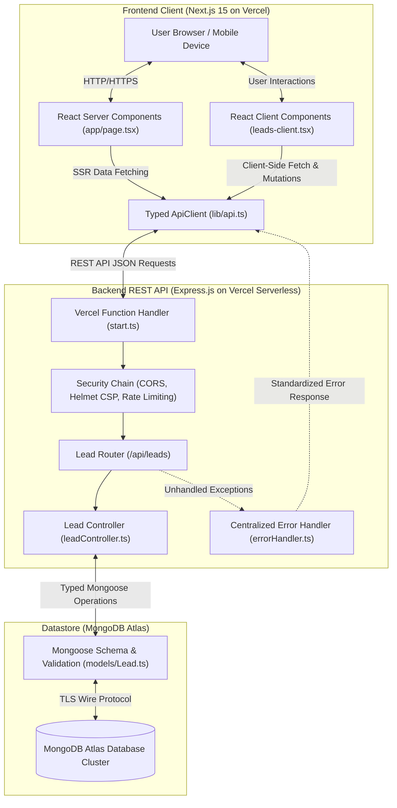
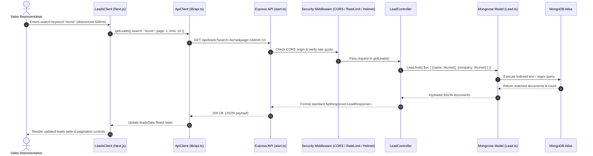
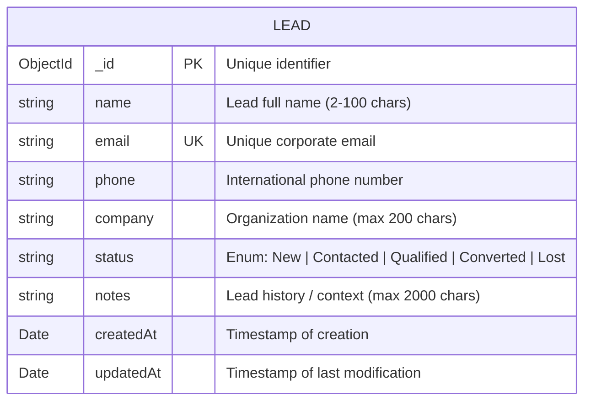

# 🚀 LeadCRM — Enterprise Full-Stack Lead Management System

[](https://nextjs.org/)
[](https://react.dev/)
[](https://www.typescriptlang.org/)
[](https://nodejs.org/)
[](https://expressjs.com/)
[](https://www.mongodb.com/atlas)
[](https://tailwindcss.com/)
[](https://vercel.com/)
[](https://opensource.org/licenses/MIT)

> A modern, production-grade Customer Relationship Management (CRM) application engineered to streamline the end-to-end sales pipeline—from prospect capture and qualification to conversion tracking and pipeline analytics. Built on a decoupled full-stack architecture utilizing **Next.js 15 App Router**, **Node.js/Express REST API**, **Mongoose ODM**, and **MongoDB Atlas**, optimized for serverless execution on **Vercel**.

---

## 🌐 Live Production Deployments & Official Links

| Service | Environment | Live URL | Status |
| :--- | :--- | :--- | :--- |
| **Frontend Web Application** | Production (Vercel) | [https://leadcrm101.vercel.app/](https://leadcrm101.vercel.app/) | ✅ Live |
| **Backend REST API** | Production (Render Web Service) | [https://leadcrm-backend101.onrender.com/](https://leadcrm-backend101.onrender.com/) | ✅ Live |
| **API Health Check** | Production Monitoring | [https://leadcrm-backend101.onrender.com/health](https://leadcrm-backend101.onrender.com/health) | ✅ Healthy |

### 👨‍💻 Author & Engineer Profiles

- **Portfolio**: [https://pawankumar.info/](https://pawankumar.info/)
- **LinkedIn**: [https://www.linkedin.com/in/pawankumar101/](https://www.linkedin.com/in/pawankumar101/)
- **LeetCode**: [https://leetcode.com/u/pk3253702/](https://leetcode.com/u/pk3253702/)
- **GitHub**: [https://github.com/POWER-WORLD](https://github.com/POWER-WORLD)

---

## 📑 Table of Contents

1. [Project Overview & Purpose](#-project-overview--purpose)
2. [Core Features](#-core-features)
3. [Technology Stack](#-technology-stack)
4. [System Architecture & Data Flow](#-system-architecture--data-flow)
5. [Repository Directory Structure](#-repository-directory-structure)
6. [Component & Service Catalog](#-component--service-catalog)
7. [Database Schema & Data Dictionary](#-database-schema--data-dictionary)
8. [REST API Specification](#-rest-api-specification)
9. [Environment Variables Configuration](#-environment-variables-configuration)
10. [Local Development & Installation](#-local-development--installation)
11. [Build, Test & Quality Verification](#-build-test--quality-verification)
12. [Vercel Production Deployment Guide](#-vercel-production-deployment-guide)
13. [Visual UI Showcase & Screenshots](#-visual-ui-showcase--screenshots)
14. [Security Architecture & Best Practices](#-security-architecture--best-practices)
15. [Troubleshooting & Diagnostics Matrix](#-troubleshooting--diagnostics-matrix)
16. [Engineering Standards & Contribution Guidelines](#-engineering-standards--contribution-guidelines)
17. [License & Acknowledgments](#-license--acknowledgments)

---

## 📌 Project Overview & Purpose

### The Business Challenge
In modern sales cycles, fast response times and clear lead qualification directly drive revenue. Development teams and sales representatives frequently encounter disjointed customer spreadsheets, lost prospect records, delayed follow-ups, and a lack of real-time pipeline visibility.

### The Solution: LeadCRM
**LeadCRM** delivers a centralized, responsive web platform designed to capture, organize, qualify, and track customer leads throughout their journey:
- **Instant Prospect Capture**: Streamlined lead intake form with real-time validation for names, international telephone formats, and corporate emails.
- **Dynamic Pipeline Visibility**: Instant searching, multi-criteria filtering by lead status, column-based sorting, and server-side pagination.
- **Executive Analytics Dashboard**: Real-time aggregated pipeline metrics displaying total leads, new prospect influx, converted deals, and calculated conversion percentages.
- **Resilient Full-Stack Architecture**: Serverless deployment model on Vercel ensuring near-zero idle resource consumption, auto-scaling capabilities, and low-latency database queries through MongoDB Atlas connection pooling.

---

## ✨ Core Features

### 1. Lead Lifecycle Management (CRUD)
- **Create**: Add new prospect details with duplicate email checking and schema validation.
- **Read**: Fetch paginated lead collections or retrieve granular lead details by unique identifier.
- **Update**: Edit contact information, company affiliation, prospect notes, or transition status (`New` ➔ `Contacted` ➔ `Qualified` ➔ `Converted` ➔ `Lost`).
- **Delete**: Safely delete lead records with user confirmation guards to prevent accidental data loss.

### 2. High-Performance Search, Filter & Sort
- **Debounced Instant Search**: 500ms debounced input dynamically searching across `name`, `email`, and `company` simultaneously.
- **Status Filter**: Rapidly isolate leads by pipeline status with a single click.
- **Bi-directional Sorting**: Order records by Creation Date, Lead Name, Email, or Company in ascending or descending sequence.
- **Server-Side Pagination**: Scalable data partitioning supporting thousands of records without frontend memory degradation.

### 3. Real-Time Pipeline Analytics
- **KPI Metrics Cards**: Total Leads, New Leads, Contacted Prospects, Qualified Prospects, and Converted Customers.
- **Conversion Rate Tracking**: Real-time aggregation pipeline computing exact closing percentages.
- **Recent Activity Feed**: Real-time listing of the latest 5 inbound prospects with instant status badges.

### 4. Enterprise-Grade Security & Reliability
- **CORS Origin Whitelisting**: Strict cross-origin policies allowing only authorized frontend domains and localhost environments.
- **Helmet HTTP Security Headers**: Content Security Policy (CSP), frameguard, MIME sniffing prevention, and XSS filtering.
- **Express Rate Limiting**: IP-based rate limiting (100 requests per 15-minute window) protecting API endpoints against DoS abuse.
- **Injection Protection**: Parameterized Mongoose queries insulating the datastore against NoSQL injection vectors.
- **Centralized Error Handling**: Standardized JSON error responses masking internal stack traces from public exposure.

---

## 🛠 Technology Stack

### Frontend Application
| Layer / Component | Technology | Version | Purpose |
| :--- | :--- | :--- | :--- |
| **Framework** | Next.js (App Router) | `15.2.8` | Server-Side Rendering (SSR), React Server Components (RSC), routing |
| **Core UI Library** | React | `19.0.0` | Declarative component tree and state synchronization |
| **Language** | TypeScript | `5.x` | Strict end-to-end type safety and compile-time contract enforcement |
| **Styling** | Tailwind CSS | `3.4.17` | Utility-first responsive design and modern color palettes |
| **Component Primitives** | Radix UI / Shadcn | Latest | Accessible, WCAG-compliant unstyled primitives (Dialog, Select, Toast) |
| **Icons** | Lucide React | `^0.454.0` | Lightweight, scalable vector iconography |
| **Data Fetching** | Fetch API / Custom ApiClient | Native | Strongly-typed HTTP abstraction with error resilience |

### Backend API Service
| Layer / Component | Technology | Version | Purpose |
| :--- | :--- | :--- | :--- |
| **Runtime** | Node.js | `>=20.x` | High-throughput asynchronous JavaScript runtime |
| **HTTP Framework** | Express.js | `^4.18.2` | RESTful routing, middleware pipelines, and controller delegation |
| **Language** | TypeScript | `^5.3.3` | Typed API contracts, models, controllers, and queries |
| **Database ODM** | Mongoose | `^8.0.3` | Object Document Mapping, schema validation, and indexing |
| **Security Headers** | Helmet | `^7.1.0` | Comprehensive HTTP security response headers and CSP |
| **Rate Limiter** | express-rate-limit | `^7.1.5` | Request rate throttling and DoS prevention |
| **CORS Middleware** | cors | `^2.8.5` | Controlled Cross-Origin Resource Sharing |
| **Configuration** | dotenv | `^16.3.1` | Decoupled 12-factor application environment management |

### Database & Cloud Infrastructure
| Component | Provider / Platform | Configuration |
| :--- | :--- | :--- |
| **Primary Database** | MongoDB Atlas | Multi-region replica set, SSL/TLS encrypted, connection pooling |
| **Frontend Hosting** | Vercel Edge Network | Next.js Serverless runtime, global CDN edge caching |
| **Backend Hosting** | Vercel Serverless Functions | `@vercel/node` builder executing `start.ts` |
| **Continuous Integration** | GitHub Actions / Vercel CI | Automated preview and production deployment triggers |

---

## 🏗 System Architecture & Data Flow

### High-Level Architecture Diagram



### End-to-End Client Request Lifecycle



---

## 📂 Repository Directory Structure

```text
LeadCRM/
├── backend/                             # Express REST API service
│   ├── controllers/
│   │   └── leadController.ts           # Business logic: CRUD, multi-field search, aggregation
│   ├── db/
│   │   └── connection.ts               # Resilient MongoDB Atlas connection manager
│   ├── middleware/
│   │   └── errorHandler.ts             # Global error handler and 404 catcher
│   ├── models/
│   │   └── Lead.ts                     # Mongoose schema, validation constraints, indexes
│   ├── routes/
│   │   └── leadRoutes.ts               # Express route endpoints mapped to controllers
│   ├── types/
│   │   └── index.ts                    # TypeScript data transfer objects, queries, responses
│   ├── .env.example                    # Safe backend environment variables template
│   ├── .gitignore                      # Backend Git exclusions
│   ├── package.json                    # Backend dependencies and execution scripts
│   ├── README.md                       # Deep-dive backend technical documentation
│   ├── start.ts                        # Application bootstrap, middleware stack, listener
│   ├── tsconfig.json                   # TypeScript compiler configuration
│   └── vercel.json                     # Vercel Serverless Function routing definition
│
├── frontend/                            # Next.js 15 App Router web application
│   ├── app/
│   │   ├── layout.tsx                  # Root layout, HTML headers, persistent navigation
│   │   ├── loading.tsx                 # Route-level loading spinner/skeleton
│   │   ├── page.tsx                    # Server Component: Dashboard & KPI analytics
│   │   └── leads/
│   │       ├── page.tsx                # Leads route wrapper with React Suspense
│   │       ├── loading.tsx             # Leads page loading skeleton
│   │       ├── leads-client.tsx        # Interactive data table, search, filters, modals
│   │       └── new/
│   │           └── page.tsx            # Inbound lead registration form with validation
│   ├── components/
│   │   ├── breadcrumb.tsx              # Dynamic breadcrumb navigation hierarchy
│   │   ├── header.tsx                  # Sticky brand navigation header with mobile drawer
│   │   ├── footer.tsx                  # Footer component with links and author profiles
│   │   └── ui/                         # Shadcn/UI (Radix UI) accessible components
│   │       ├── button.tsx, card.tsx, dialog.tsx, input.tsx, table.tsx, etc.
│   │       └── ...
│   ├── hooks/
│   │   ├── use-mobile.tsx              # Responsive viewport breakpoint detection hook
│   │   └── use-toast.ts                # Toast notification management hook
│   ├── lib/
│   │   ├── api.ts                      # Centralized typed ApiClient singleton
│   │   └── utils.ts                    # Tailwind CSS class merging utility
│   ├── public/
│   │   ├── favicon.svg                 # Application favicon
│   │   └── screenshots/                # Application visual documentation screenshots
│   │       ├── Screenshot 2026-06-06 190629.png
│   │       ├── Screenshot 2026-06-06 190701.png
│   │       ├── Screenshot 2026-06-06 190728.png
│   │       └── Screenshot 2026-06-06 190811.png
│   ├── styles/
│   │   └── globals.css                 # Tailwind CSS styles and theme variables
│   ├── types/
│   │   └── lead.ts                     # Frontend TypeScript domain types
│   ├── .env.example                    # Safe frontend environment variables template
│   ├── components.json                 # Shadcn CLI configuration manifest
│   ├── next.config.mjs                 # Next.js compilation configuration
│   ├── package.json                    # Frontend dependencies and execution scripts
│   ├── postcss.config.mjs              # PostCSS build configuration
│   ├── README.md                       # Deep-dive frontend technical documentation
│   ├── tailwind.config.ts              # Tailwind CSS theme and token definitions
│   └── tsconfig.json                   # Frontend TypeScript strict compiler settings
│
└── README.md                           # Master repository documentation (this file)
```

---

## 🧩 Component & Service Catalog

### Frontend Architecture
- **Root Layout (`frontend/app/layout.tsx`)**: Establishes global HTML document structure, sets metadata, applies global font configurations, and injects persistent `Header`, `Footer`, and `Toaster` components.
- **Dashboard (`frontend/app/page.tsx`)**: Server-rendered view utilizing Next.js `force-dynamic` rendering. It directly calls `apiClient.getLeadStats()` and `apiClient.getLeads({ limit: 5 })` to hydrate KPI cards and the recent activity feed without exposing credentials or causing client-side layout shifts.
- **Leads Client Grid (`frontend/app/leads/leads-client.tsx`)**: Highly optimized Client Component managing interactive state:
  - Custom `useDebounce` hook buffering search inputs by 500ms.
  - URL search parameter synchronization (`useSearchParams` / `router.push`).
  - Inline lead status dropdowns triggering non-blocking background updates.
  - Dynamic editing dialog with pre-populated form fields and validation.
  - Safe confirmation modal preventing accidental deletions.
- **Lead Creation Form (`frontend/app/leads/new/page.tsx`)**: Controlled React form equipped with client-side regex validators for emails and phone numbers, displaying actionable error messages and redirection to the leads view upon success.
- **API Client Service (`frontend/lib/api.ts`)**: Encapsulated singleton pattern managing network requests, JSON serialization, query parameter formatting, and unified exception handling.

### Backend Architecture
- **Application Bootstrap (`backend/start.ts`)**: Instantiates Express, configures `trust proxy: 1` for accurate Vercel IP extraction, attaches CORS origin policies, applies Helmet CSP directives, enforces rate limits, handles JSON body parsing with a 10MB limit, routes `/api/leads`, and registers the global error handler.
- **Lead Controller (`backend/controllers/leadController.ts`)**:
  - `getLeads`: Handles paginated queries, case-insensitive multi-field search (`$or` with `$regex`), status filtering, and dynamic field sorting.
  - `createLead`: Enforces required field validation, checks for email uniqueness before persistence, and saves validated documents.
  - `getLeadById`: Validates MongoDB ObjectIds and fetches individual lead records.
  - `updateLead`: Applies partial document updates with `{ new: true, runValidators: true }` while verifying that updated emails do not conflict with existing records.
  - `deleteLead`: Removes records and returns standardized success acknowledgments.
  - `getLeadStats`: Executes a MongoDB aggregation pipeline (`$group` on `$status`) to generate global metrics and calculate real-time conversion rates.
- **Database Connection Manager (`backend/db/connection.ts`)**: Manages the Mongoose connection lifecycle, handles connection errors gracefully, and optimizes connection reuse across serverless function invocations.
- **Centralized Error Handler (`backend/middleware/errorHandler.ts`)**: Intercepts Mongoose `ValidationError`, `CastError` (invalid ObjectId), and MongoDB duplicate key `11000` errors, translating them into human-readable 400 Bad Request responses.

---

## 🗄️ Database Schema & Data Dictionary

### Entity-Relationship Diagram



### Data Dictionary

| Column / Field | Mongoose Type | Required | Unique | Validation Rules & Defaults | Description |
| :--- | :--- | :--- | :--- | :--- | :--- |
| `_id` | `ObjectId` | Auto | Yes | Generated by MongoDB Atlas | Primary internal document key |
| `name` | `String` | Yes | No | Min: 2, Max: 100 characters; trimmed | Full name of the prospect |
| `email` | `String` | Yes | Yes | Pattern: `/^\w+([.-]?\w+)*@\w+([.-]?\w+)*(\.\w{2,3})+$/`; lowercase | Corporate email address |
| `phone` | `String` | Yes | No | Pattern: `/^[\+]?[(]?[0-9]{1,4}[)]?[-\s\./0-9]*$/`; trimmed | Contact telephone number |
| `company` | `String` | Yes | No | Max: 200 characters; trimmed | Prospect company or employer |
| `status` | `String` | Yes | No | Enum: `["New", "Contacted", "Qualified", "Converted", "Lost"]`; Default: `"New"` | Current stage in sales funnel |
| `notes` | `String` | No | No | Max: 2,000 characters; Default: `""` | Additional notes or meeting logs |
| `createdAt` | `Date` | Auto | No | Managed via `{ timestamps: true }` | Timestamp when lead was captured |
| `updatedAt` | `Date` | Auto | No | Managed via `{ timestamps: true }` | Timestamp when lead was last modified |

### Indexing Strategy
To guarantee predictable, sub-10 millisecond response times under production query loads, the following indexes are actively enforced on the `leads` collection:
1. **Unique Email Index**: `{ email: 1 }` (Unique constraint enforcement and instantaneous lookups).
2. **Status Index**: `{ status: 1 }` (Accelerates status filter queries and aggregation pipelines).
3. **Chronological Index**: `{ createdAt: -1 }` (Optimizes default descending sort and activity feeds).
4. **Text Compound Index**: `{ name: "text", email: "text", company: "text" }` (Powers fast full-text multi-field search).

---

## 🔌 REST API Specification

### Endpoints Overview

| Method | Route | Description | Query / Body Parameters | Success Code |
| :--- | :--- | :--- | :--- | :--- |
| `GET` | `/health` | Health check & uptime monitoring | None | `200 OK` |
| `GET` | `/api/leads` | Paginated search, filter & sort | `page`, `limit`, `search`, `status`, `sortBy`, `sortOrder` | `200 OK` |
| `GET` | `/api/leads/stats` | Pipeline statistics & conversion rate | None | `200 OK` |
| `GET` | `/api/leads/:id` | Fetch single lead record | Route param `:id` (24-char hex ObjectId) | `200 OK` |
| `POST` | `/api/leads` | Create a new lead | JSON body (`name`, `email`, `phone`, `company`, `status`, `notes`) | `201 Created` |
| `PUT` | `/api/leads/:id` | Update lead record | Route param `:id` + JSON body (partial fields) | `200 OK` |
| `DELETE` | `/api/leads/:id` | Remove lead record | Route param `:id` | `200 OK` |

---

### Request & Response Samples

#### 1. Retrieve Paginated Leads
- **Request**: `GET /api/leads?page=1&limit=2&status=Qualified&sortBy=createdAt&sortOrder=desc`
- **Response `200 OK`**:
```json
{
  "success": true,
  "data": {
    "leads": [
      {
        "_id": "666248901234567890abcdef",
        "name": "Sarah Connor",
        "email": "sarah.connor@cyberdyne.com",
        "phone": "+1-310-555-0199",
        "company": "Cyberdyne Systems",
        "status": "Qualified",
        "notes": "Requested comprehensive CRM migration proposal.",
        "createdAt": "2026-11-21T08:30:00.000Z",
        "updatedAt": "2026-11-21T09:15:00.000Z"
      }
    ],
    "total": 1,
    "page": 1,
    "limit": 2,
    "totalPages": 1
  }
}
```

#### 2. Retrieve Pipeline Analytics
- **Request**: `GET /api/leads/stats`
- **Response `200 OK`**:
```json
{
  "success": true,
  "data": {
    "total": 25,
    "statusCounts": {
      "New": 7,
      "Contacted": 8,
      "Qualified": 5,
      "Converted": 3,
      "Lost": 2
    },
    "conversionRate": 12
  }
}
```

#### 3. Create a New Lead
- **Request**: `POST /api/leads`
- **Headers**: `Content-Type: application/json`
- **Payload**:
```json
{
  "name": "Marcus Vance",
  "email": "m.vance@apexglobal.com",
  "phone": "+1 (415) 555-2671",
  "company": "Apex Global Solutions",
  "status": "New",
  "notes": "Attended product webinar on automated sales workflows."
}
```
- **Response `201 Created`**:
```json
{
  "success": true,
  "data": {
    "id": "666249991234567890aabbcc",
    "name": "Marcus Vance",
    "email": "m.vance@apexglobal.com",
    "phone": "+1 (415) 555-2671",
    "company": "Apex Global Solutions",
    "status": "New",
    "notes": "Attended product webinar on automated sales workflows.",
    "createdAt": "2026-11-21T10:15:00.000Z",
    "updatedAt": "2026-11-21T10:15:00.000Z"
  },
  "message": "Lead created successfully"
}
```

#### 4. Update Existing Lead
- **Request**: `PUT /api/leads/666249991234567890aabbcc`
- **Payload**:
```json
{
  "status": "Contacted",
  "notes": "Initial discovery call conducted. Demo scheduled for next Tuesday."
}
```
- **Response `200 OK`**:
```json
{
  "success": true,
  "data": {
    "id": "666249991234567890aabbcc",
    "name": "Marcus Vance",
    "email": "m.vance@apexglobal.com",
    "phone": "+1 (415) 555-2671",
    "company": "Apex Global Solutions",
    "status": "Contacted",
    "notes": "Initial discovery call conducted. Demo scheduled for next Tuesday.",
    "createdAt": "2026-11-21T10:15:00.000Z",
    "updatedAt": "2026-11-21T10:30:00.000Z"
  },
  "message": "Lead updated successfully"
}
```

#### 5. Delete Lead
- **Request**: `DELETE /api/leads/666249991234567890aabbcc`
- **Response `200 OK`**:
```json
{
  "success": true,
  "message": "Lead deleted successfully"
}
```

---

## ⚙️ Environment Variables Configuration

Both the frontend and backend utilize decoupled environment configurations. Safe template files (`.env.example`) are provided in both directories.

### Backend Environment Template (`backend/.env.example`)

```env
# Port number for local Express server execution
PORT=5000

# Application execution environment: 'development' | 'production' | 'test'
NODE_ENV=development

# MongoDB Atlas connection string URI
MONGODB_URI=mongodb+srv://<username>:<password>@cluster0.mongodb.net/leadcrm?retryWrites=true&w=majority

# Frontend client origin allowed by CORS policy
FRONTEND_URL=http://localhost:3000
```

### Frontend Environment Template (`frontend/.env.example`)

```env
# Backend REST API Base URL
# Development: http://localhost:5000/api
# Production (Render): https://leadcrm-backend101.onrender.com/api
NEXT_PUBLIC_API_URL=https://leadcrm-backend101.onrender.com/api
```

### Environment Variables Reference Table

| Variable Name | Location | Required | Default / Example | Security Consideration |
| :--- | :--- | :--- | :--- | :--- |
| `PORT` | `backend/.env` | Optional | `5000` | Port for local server process. |
| `NODE_ENV` | `backend/.env` | Yes | `development` | Dictates listener behavior and error stack verbosity. |
| `MONGODB_URI` | `backend/.env` | **Critical** | `mongodb+srv://...` | **Secret**: Grants access to database cluster. Never commit! |
| `FRONTEND_URL` | `backend/.env` | Yes | `http://localhost:3000` | Whitelisted by CORS to prevent cross-origin abuse. |
| `NEXT_PUBLIC_API_URL` | `frontend/.env.local` | Yes | `http://localhost:5000/api` | Publicly exposed to client browser to direct fetch calls. |

---

## 🚀 Local Development & Installation

### System Prerequisites
- **Node.js**: `v20.x` or later (LTS recommended)
- **Package Manager**: `npm` (`v10.x`+) or `pnpm`
- **Database**: Access to a MongoDB Atlas cluster or a local MongoDB server (`v6.x`+)
- **Git**: Installed and configured

---

### Step-by-Step Setup Guide

#### 1. Clone the Repository
```bash
git clone https://github.com/POWER-WORLD/LeadCRM_web.git
cd LeadCRM_web
```

#### 2. Backend Setup & Startup
```bash
# Navigate to backend directory
cd backend

# Create local environment file from template
cp .env.example .env

# Open .env and insert your real MONGODB_URI connection string
# nano .env or code .env

# Install dependencies
npm install

# Start backend in development mode with live reloading
npm run dev
```
*The backend API will start at `http://localhost:5000`.* Verify by visiting `http://localhost:5000/health`.

#### 3. Frontend Setup & Startup (in a new terminal)
```bash
# Navigate to frontend directory
cd frontend

# Create local environment file from template
cp .env.example .env.local

# Install dependencies
npm install

# Start frontend development server
npm run dev
```
*The frontend application will start at `http://localhost:3000`.* Open your browser and navigate to `http://localhost:3000`.

---

## 🧪 Build, Test & Quality Verification

Run these verification commands before committing changes or preparing deployments:

### Backend Verification
```bash
cd backend

# 1. TypeScript Static Type Checking
npm run check

# 2. Production Build Compilation (creates /dist)
npm run build

# 3. Clean Rebuild Verification
npm run build:clean
```

### Frontend Verification
```bash
cd frontend

# 1. ESLint Code Quality Inspection
npm run lint

# 2. Production Next.js Bundle Compilation
npm run build

# 3. Test Production Server Locally
npm run start
```

---

## ☁️ Vercel Production Deployment Guide

The application is structured for zero-friction deployment on Vercel's global serverless platform.

### Backend Deployment (`backend/`)
### Backend Deployment on Render (`backend/`)
1. In the **Render Dashboard**, select **New +** -> **Web Service** and connect the `LeadCRM_web` repository (or deploy via blueprint `render.yaml`).
2. Configure **Root Directory** as `backend`.
3. Set **Runtime**: `Node`.
4. Set **Build Command**: `npm install && npm run build`.
5. Set **Start Command**: `npm start`.
6. Set **Health Check Path**: `/health`.
7. In **Environment Variables**, add:
   - `NODE_ENV` = `production`
   - `MONGODB_URI` = `mongodb+srv://<username>:<password>@cluster0.mongodb.net/leadcrm?retryWrites=true&w=majority`
   - `FRONTEND_URL` = `https://lead-crm-web.vercel.app`
   - `ALLOWED_ORIGINS` = `https://lead-crm-web.vercel.app,http://localhost:3000`
   - `BACKEND_URL` = `https://lead-crm-web-backend.onrender.com`
   - `JWT_SECRET` = *(secure random string min 32 chars)*
8. Click **Create Web Service**.
9. Production Endpoint: [https://leadcrm-backend101.onrender.com/](https://leadcrm-backend101.onrender.com/)

### Frontend Deployment on Vercel (`frontend/`)
1. In the **Vercel Dashboard**, select **Add New Project** and import the `LeadCRM_web` repository.
2. Configure **Root Directory** as `frontend`.
3. Select **Framework Preset**: `Next.js`.
4. In **Environment Variables**, add:
   - `NEXT_PUBLIC_API_URL` = `https://leadcrm-backend101.onrender.com/api`
5. Click **Deploy**. Next.js App Router will compile with automatic Edge caching.
6. Production Application: [https://leadcrm101.vercel.app/](https://leadcrm101.vercel.app/)

---

## 📸 Visual UI Showcase & Screenshots

### 1. Executive Dashboard & Real-Time Analytics
*Overview of pipeline performance, total leads, active prospect count, and dynamically calculated conversion percentage.*


---

### 2. Lead Management Data Grid & Multi-Filter View
*Interactive prospect database with multi-field instant search, status filtering dropdown, column sorting, and inline actions.*


---

### 3. Inbound Lead Registration Workflow
*Clean, responsive form with real-time field validation for names, international telephone standards, and corporate emails.*


---

### 4. Conversion Analytics & Status Distribution
*Categorical breakdown of prospect progression throughout every stage of the sales pipeline.*


---

## 🛡️ Security Architecture & Best Practices

1. **Strict Cross-Origin Resource Sharing (CORS)**:
   - Origin resolution explicitly checks incoming request headers against `allowedOrigins` (`process.env.FRONTEND_URL`, `https://lead-crm-web.vercel.app`, and `http://localhost:3000`).
   - Unauthorized origins receive immediate `403 / CORS Error` responses.
2. **Helmet Defense-in-Depth**:
   - Injects Content Security Policy (CSP) directives restricting script, style, and connect boundaries.
   - Disables client MIME type sniffing (`X-Content-Type-Options: nosniff`).
   - Restricts iframe embedding to defeat clickjacking attacks (`X-Frame-Options: SAMEORIGIN`).
3. **Adaptive Rate Limiting**:
   - `express-rate-limit` enforces a 100-request quota per 15-minute sliding window per client IP.
   - Prevents credential stuffing, rapid-fire search scraping, and Denial of Service (DoS) attacks.
4. **NoSQL Injection Immunity**:
   - Mongoose strictly validates input against strong type definitions before constructing queries.
   - Disallows arbitrary operator injection (`$gt`, `$ne`, `$where`) from untrusted JSON payloads.
5. **Safe Serverless Execution**:
   - Standalone listener (`app.listen`) is dynamically suppressed in production serverless environments, allowing Vercel's lifecycle manager to handle concurrency cleanly.

---

## 🔧 Troubleshooting & Diagnostics Matrix

| Symptom / Error | Root Cause | Verified Resolution |
| :--- | :--- | :--- |
| **`CORS error: Not allowed by CORS`** | Request origin does not match `allowedOrigins` in `start.ts`. | Add your custom domain to `FRONTEND_URL` in the backend environment variables or check trailing slashes. |
| **`MongooseServerSelectionError: connect ECONNREFUSED`** | Backend cannot reach MongoDB Atlas cluster. | Verify IP Whitelist in MongoDB Atlas (`0.0.0.0/0` for Vercel functions) and check `MONGODB_URI` credentials. |
| **`Warning: NEXT_PUBLIC_API_URL is undefined`** | Missing environment variable during Next.js build. | Ensure `.env.local` exists locally, or configure `NEXT_PUBLIC_API_URL` in Vercel Project Settings. |
| **`CastError: Cast to ObjectId failed for value ...`** | Malformed lead ID passed into `/api/leads/:id`. | The API's centralized error handler catches this and returns `400 Bad Request: Invalid ID format`. Verify the 24-character hexadecimal string. |
| **`Duplicate field value entered (Code 11000)`** | Attempted to register a lead with an email that already exists. | Email addresses must be unique. Update the existing record or specify a different email. |
| **`Too many requests from this IP`** | Client exceeded the 100 requests / 15-minute rate limit. | Wait for the sliding window to reset or adjust the `max` threshold in `start.ts` for enterprise workloads. |

---

## 📐 Engineering Standards & Contribution Guidelines

We adhere strictly to Senior Software Engineering practices, clean code principles, and **Global Naming Standardization**:

### Coding Standards
- **Clean Architecture**: Clear separation of concerns across presentation, routing, controller business logic, and datastore layers.
- **Naming Conventions**:
  - `PascalCase` for React components (`LeadsClient`, `Header`, `Breadcrumb`), Mongoose models (`Lead`), and TypeScript interfaces (`LeadDocument`, `ApiResponse`).
  - `camelCase` for functions, controller methods (`getLeads`, `createLead`), route instances, and utility hooks (`useDebounce`).
  - `UPPER_SNAKE_CASE` for configuration constants and environment variable keys (`MONGODB_URI`, `API_BASE_URL`).
  - `kebab-case` for UI file naming conventions (`leads-client.tsx`, `use-mobile.tsx`).
- **No Shortcuts**: Explicit typing throughout—avoid `any` wherever concrete interfaces can be established. Validate inputs on both client and server layers.

### Contribution Workflow
1. Fork the repository on GitHub.
2. Create a feature branch: `git checkout -b feature/advanced-lead-export`
3. Commit your changes following conventional commits: `git commit -m "feat(export): add CSV and PDF lead reporting capability"`
4. Verify all tests and builds pass:
   ```bash
   cd backend && npm run check && npm run build
   cd ../frontend && npm run lint && npm run build
   ```
5. Push to your branch: `git push origin feature/advanced-lead-export`
6. Open a Pull Request detailing changes, architecture impact, and test evidence.

---

## 📄 License & Acknowledgments

Distributed under the **MIT License**. See `LICENSE` for more information.

Developed with precision by **Pawan Kumar** as a production-grade full-stack demonstration.

- **Portfolio**: [https://pawankumar.info/](https://pawankumar.info/)
- **LinkedIn**: [https://www.linkedin.com/in/pawankumar101/](https://www.linkedin.com/in/pawankumar101/)
- **LeetCode**: [https://leetcode.com/u/pk3253702/](https://leetcode.com/u/pk3253702/)
- **GitHub**: [https://github.com/POWER-WORLD](https://github.com/POWER-WORLD)
