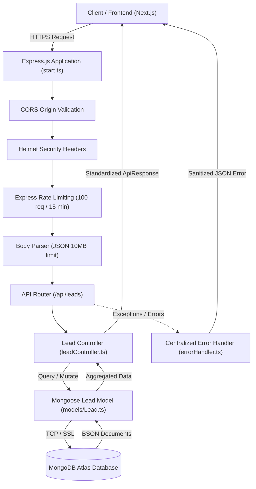

# ⚙️ LeadCRM Backend - Technical Documentation

> Production-grade Node.js/Express REST API service for LeadCRM, engineered with TypeScript, Mongoose ODM, MongoDB Atlas, and deployed on Vercel Serverless Functions.

---

## 📌 Architectural Overview

The **LeadCRM Backend** provides high-performance, fault-tolerant RESTful API endpoints powering the LeadCRM ecosystem. It manages customer lead lifecycle events, performs server-side search querying, computes aggregated CRM analytics, enforces strict validation constraints, and secures communications through enterprise middleware.



---

## 📂 Backend Directory Structure

```text
backend/
├── controllers/
│   └── leadController.ts       # Request handlers (CRUD, search, filtering, statistics)
├── db/
│   └── connection.ts           # Mongoose database connection lifecycle manager
├── middleware/
│   └── errorHandler.ts         # Centralized error handler and 404 route catcher
├── models/
│   └── Lead.ts                 # Mongoose schema, validation rules, and indexes
├── routes/
│   └── leadRoutes.ts           # Express route definitions for /api/leads
├── types/
│   └── index.ts                # TypeScript type definitions, queries, and DTOs
├── .env.example                # Safe environment variable configuration template
├── .gitignore                  # Git exclusions (node_modules, dist, .env)
├── package.json                # Dependencies, build scripts, engine constraints
├── start.ts                    # Main application entry point, middleware assembly, server listener
├── tsconfig.json               # TypeScript compiler configuration
└── vercel.json                 # Vercel Serverless Function routing configuration
```

---

## 🔌 API Endpoints Reference

Base URL (Local): `http://localhost:5000`  
Base URL (Production): `https://lead-crm-web-backend.onrender.com`

### Summary of Endpoints

| HTTP Method | Endpoint | Description | Auth | Rate Limited |
| :--- | :--- | :--- | :--- | :--- |
| `GET` | `/health` | Health check endpoint returning server status | Public | Yes |
| `GET` | `/api/leads` | Retrieve paginated leads with search, filter, and sort | Public | Yes |
| `GET` | `/api/leads/stats` | Retrieve aggregated pipeline statistics and conversion rate | Public | Yes |
| `GET` | `/api/leads/:id` | Retrieve single lead document by MongoDB ObjectId | Public | Yes |
| `POST` | `/api/leads` | Create a new lead record | Public | Yes |
| `PUT` | `/api/leads/:id` | Update an existing lead record | Public | Yes |
| `DELETE` | `/api/leads/:id` | Delete an existing lead record | Public | Yes |

---

### Detailed Endpoint Specifications

#### 1. Server Health Check
- **Endpoint**: `GET /health`
- **Response `200 OK`**:
```json
{
  "success": true,
  "message": "Server is running",
  "timestamp": "2026-11-21T10:45:00.000Z"
}
```

#### 2. Get All Leads (Paginated & Filtered)
- **Endpoint**: `GET /api/leads`
- **Query Parameters**:
  - `page` (number, default: `1`): Current page index (minimum: 1).
  - `limit` (number, default: `10`, max: `50`): Leads per page.
  - `search` (string, optional): Case-insensitive search on `name`, `email`, and `company`.
  - `status` (string, optional): Filter by `"New" | "Contacted" | "Qualified" | "Converted" | "Lost" | "all"`.
  - `sortBy` (string, default: `"createdAt"`): Field to sort by (`"name" | "email" | "company" | "createdAt"`).
  - `sortOrder` (string, default: `"desc"`): Sort order (`"asc" | "desc"`).
- **Response `200 OK`**:
```json
{
  "success": true,
  "data": {
    "leads": [
      {
        "_id": "666248901234567890abcdef",
        "name": "Jane Doe",
        "email": "jane.doe@acme.com",
        "phone": "+1 (555) 234-5678",
        "company": "Acme Corporation",
        "status": "Qualified",
        "notes": "Interested in enterprise CRM migration.",
        "createdAt": "2026-06-06T12:00:00.000Z",
        "updatedAt": "2026-06-06T12:30:00.000Z"
      }
    ],
    "total": 42,
    "page": 1,
    "limit": 10,
    "totalPages": 5
  }
}
```

#### 3. Get Pipeline Analytics Statistics
- **Endpoint**: `GET /api/leads/stats`
- **Description**: Uses a high-performance MongoDB aggregation pipeline (`$group` on status) to calculate real-time counts and overall conversion rate percentage.
- **Response `200 OK`**:
```json
{
  "success": true,
  "data": {
    "total": 42,
    "statusCounts": {
      "New": 12,
      "Contacted": 14,
      "Qualified": 8,
      "Converted": 5,
      "Lost": 3
    },
    "conversionRate": 12
  }
}
```

#### 4. Get Lead by ID
- **Endpoint**: `GET /api/leads/:id`
- **Response `200 OK`**: Single Lead document object.
- **Response `404 Not Found`**:
```json
{
  "success": false,
  "error": "Lead not found"
}
```

#### 5. Create New Lead
- **Endpoint**: `POST /api/leads`
- **Request Headers**: `Content-Type: application/json`
- **Request Body**:
```json
{
  "name": "Alexander Wright",
  "email": "a.wright@enterprise.io",
  "phone": "+1-800-555-0199",
  "company": "Enterprise Global Technologies",
  "status": "New",
  "notes": "Inbound lead from product landing page."
}
```
- **Response `201 Created`**:
```json
{
  "success": true,
  "data": {
    "id": "666249011234567890fedcba",
    "name": "Alexander Wright",
    "email": "a.wright@enterprise.io",
    "phone": "+1-800-555-0199",
    "company": "Enterprise Global Technologies",
    "status": "New",
    "notes": "Inbound lead from product landing page.",
    "createdAt": "2026-11-21T10:48:00.000Z",
    "updatedAt": "2026-11-21T10:48:00.000Z"
  },
  "message": "Lead created successfully"
}
```
- **Validation Errors `400 Bad Request`**:
```json
{
  "success": false,
  "error": "A lead with this email already exists"
}
```

#### 6. Update Lead
- **Endpoint**: `PUT /api/leads/:id`
- **Request Body** (partial fields supported):
```json
{
  "status": "Contacted",
  "notes": "Followed up via phone call. Scheduled demo."
}
```
- **Response `200 OK`**:
```json
{
  "success": true,
  "data": {
    "id": "666249011234567890fedcba",
    "name": "Alexander Wright",
    "email": "a.wright@enterprise.io",
    "phone": "+1-800-555-0199",
    "company": "Enterprise Global Technologies",
    "status": "Contacted",
    "notes": "Followed up via phone call. Scheduled demo.",
    "createdAt": "2026-11-21T10:48:00.000Z",
    "updatedAt": "2026-11-21T11:00:00.000Z"
  },
  "message": "Lead updated successfully"
}
```

#### 7. Delete Lead
- **Endpoint**: `DELETE /api/leads/:id`
- **Response `200 OK`**:
```json
{
  "success": true,
  "message": "Lead deleted successfully"
}
```

---

## 🗄️ Database Model & Indexing Strategy

### Schema Definition (`models/Lead.ts`)

| Field | Type | Required | Unique | Validation / Constraint |
| :--- | :--- | :--- | :--- | :--- |
| `name` | `String` | Yes | No | Min 2 chars, Max 100 chars, trimmed |
| `email` | `String` | Yes | Yes | Valid email regex pattern, lowercase, trimmed |
| `phone` | `String` | Yes | No | Valid international phone regex pattern, trimmed |
| `company` | `String` | Yes | No | Max 200 chars, trimmed |
| `status` | `String` | Yes | No | Enum: `["New", "Contacted", "Qualified", "Converted", "Lost"]`, default: `"New"` |
| `notes` | `String` | No | No | Max 2000 chars, trimmed, default: `""` |
| `createdAt` | `Date` | Auto | No | Mongoose `timestamps: true` |
| `updatedAt` | `Date` | Auto | No | Mongoose `timestamps: true` |

### Database Indexes

To maintain sub-10ms response times at scale, the collection implements the following indexes:
1. `leadSchema.index({ email: 1 })`: Enforces uniqueness and accelerates duplicate checks.
2. `leadSchema.index({ status: 1 })`: Optimizes status filtering and aggregation queries.
3. `leadSchema.index({ createdAt: -1 })`: Powers chronologically ordered listing and dashboard feeds.
4. `leadSchema.index({ name: "text", email: "text", company: "text" })`: Enables high-speed multi-field search operations.

---

## 🛡️ Security Architecture

1. **CORS (Cross-Origin Resource Sharing)**:
   - Configured with strict origin whitelisting:
     - `process.env.FRONTEND_URL`
     - `https://lead-crm-web.vercel.app`
     - `http://localhost:3000` (for local development)
   - Credentials support enabled (`credentials: true`).
   - Allowed HTTP Methods: `GET`, `POST`, `PUT`, `DELETE`, `OPTIONS`.
   - Global preflight request handling (`app.options('*', cors())`).
2. **Helmet Security Headers & Content Security Policy (CSP)**:
   - Secures HTTP headers against clickjacking, MIME sniffing, and cross-site scripting.
   - Enforces explicit `defaultSrc`, `styleSrc`, `scriptSrc`, and `connectSrc` policies.
3. **Rate Limiting**:
   - `express-rate-limit` enforces a window of 15 minutes with a 100-request quota per IP address to safeguard serverless instances against DoS and credential brute-forcing.
4. **Injection Prevention**:
   - Mongoose strictly validates data types against schemas, preventing arbitrary NoSQL injection operators from executing unauthorized queries.
5. **Payload Size Restrictions**:
   - Body parsing limit enforced at `10mb` for `express.json()` and `express.urlencoded()`.

---

## ⚙️ Environment Variables

Copy `.env.example` to `.env` in the backend root:

```env
PORT=5000
NODE_ENV=development
MONGODB_URI=mongodb+srv://<username>:<password>@cluster0.mongodb.net/leadcrm?retryWrites=true&w=majority
FRONTEND_URL=http://localhost:3000
```

---

## 🚀 Local Development & Execution

```bash
# Navigate to backend directory
cd backend

# Install project dependencies
npm install

# Run TypeScript type check
npm run check

# Start development server with live reload
npm run dev

# Compile TypeScript to JavaScript (dist/)
npm run build

# Start production compiled server
npm run start
```

---

## ☁️ Vercel Serverless Deployment

The backend is configured for zero-configuration serverless deployment on Vercel through `backend/vercel.json`:

```json
{
  "version": 2,
  "builds": [
    {
      "src": "start.ts",
      "use": "@vercel/node"
    }
  ],
  "routes": [
    {
      "src": "/(.*)",
      "dest": "start.ts"
    }
  ]
}
```

Notice that `start.ts` conditionally attaches `app.listen()` only when `process.env.NODE_ENV !== 'production'`, allowing Vercel's `@vercel/node` runner to seamlessly export `app` as a serverless event handler.

---

## 🔗 Production Links

- **Production API Health**: [https://leadcrm-backend101.onrender.com/health](https://leadcrm-backend101.onrender.com/health)
- **Production API Base**: [https://leadcrm-backend101.onrender.com/](https://leadcrm-backend101.onrender.com/)
- **Live Frontend Application**: [https://leadcrm101.vercel.app/](https://leadcrm101.vercel.app/)

---

## 👨‍💻 Author Information

- **Developer**: Pawan Kumar
- **Portfolio**: [https://pawankumar.info/](https://pawankumar.info/)
- **LinkedIn**: [https://www.linkedin.com/in/pawankumar101/](https://www.linkedin.com/in/pawankumar101/)
- **LeetCode**: [https://leetcode.com/u/pk3253702/](https://leetcode.com/u/pk3253702/)
- **GitHub**: [https://github.com/POWER-WORLD](https://github.com/POWER-WORLD)
