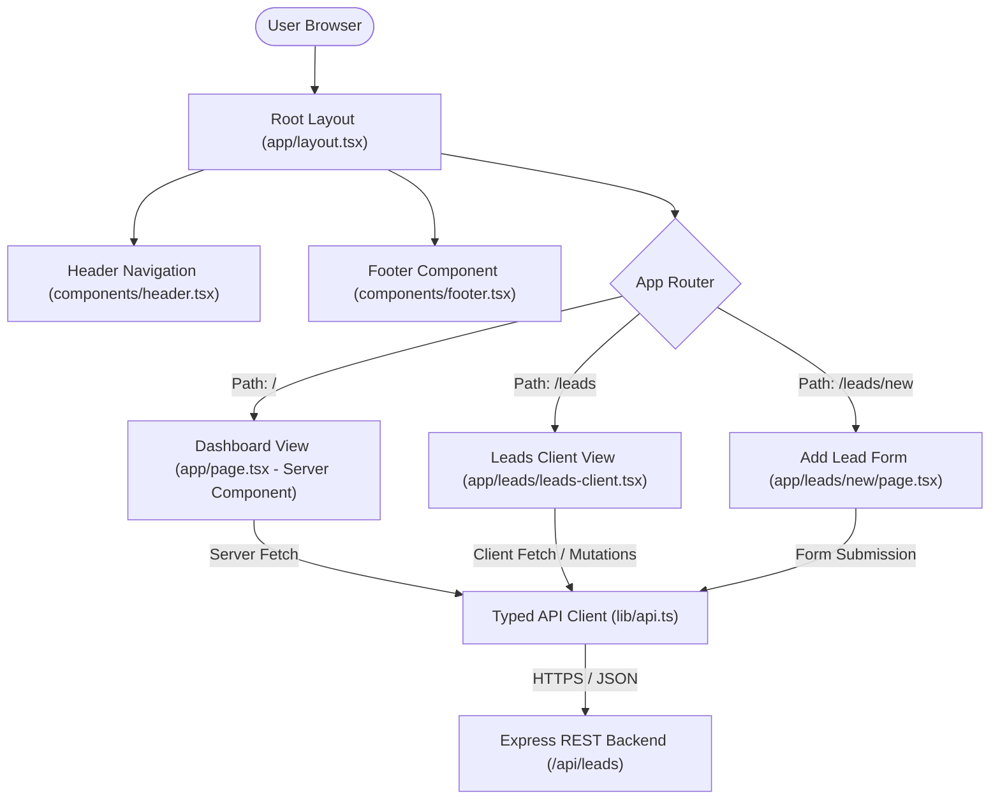

# 💻 LeadCRM Frontend - Technical Documentation

> Production-ready Next.js 15 App Router client application for LeadCRM, engineered with React 19, TypeScript, Tailwind CSS, Shadcn/UI (Radix UI), and deployed on Vercel.

---

## 📌 Architectural Overview

The **LeadCRM Frontend** delivers a fluid, responsive, accessible, and high-performance customer relationship management experience. It is built upon the Next.js 15 App Router architecture, utilizing React Server Components (RSC) for initial server-side hydration and analytics retrieval, paired with optimized Client Components for interactive search, multi-faceted filtering, modal dialogs, and instant status updates.



---

## 📂 Frontend Directory Structure

```text
frontend/
├── app/
│   ├── layout.tsx              # Root HTML structure, fonts, toaster, header & footer wrapper
│   ├── page.tsx                # Dashboard view (Server Component fetching analytics & recent leads)
│   ├── leads/
│   │   ├── page.tsx            # Leads route wrapper with React Suspense boundary
│   │   ├── loading.tsx         # Route-level loading skeleton
│   │   ├── leads-client.tsx    # Interactive leads data table, debounce search, filters, modals
│   │   └── new/
│   │       └── page.tsx        # Add new lead form with client-side validation
├── components/
│   ├── breadcrumb.tsx          # Dynamic route path navigation breadcrumbs
│   ├── header.tsx              # Sticky navigation header with mobile drawer toggle
│   ├── footer.tsx              # Brand footer with social links, sitemap, author details
│   └── ui/                     # Shadcn / Radix UI accessible UI component library
│       ├── button.tsx, card.tsx, dialog.tsx, input.tsx, select.tsx, table.tsx, etc.
├── hooks/
│   ├── use-mobile.tsx          # Window viewport breakpoint listener hook
│   └── use-toast.ts            # Toast notification management hook
├── lib/
│   ├── api.ts                  # Centralized TypeScript REST ApiClient singleton
│   └── utils.ts                # ClassName merger (clsx + tailwind-merge)
├── public/
│   ├── favicon.svg             # Application brand favicon
│   └── screenshots/            # UI screenshots illustrating features
├── styles/
│   └── globals.css             # Tailwind base layers, CSS variables, color palettes
├── types/
│   └── lead.ts                 # Frontend TypeScript interfaces and status types
├── .env.example                # Safe environment variable configuration template
├── components.json             # Shadcn CLI configuration manifest
├── next.config.mjs             # Next.js compiler settings and environment flags
├── package.json                # NPM packages, dependencies, and scripts
├── postcss.config.mjs          # PostCSS processor configuration
├── tailwind.config.ts          # Tailwind CSS design system design tokens
└── tsconfig.json               # TypeScript strict configuration
```

---

## ✨ Features & User Interface Breakdown

### 1. Dashboard View (`app/page.tsx`)
- **Server-Side Data Fetching**: Renders on the server using `export const dynamic = 'force-dynamic'` to ensure fresh analytics metrics upon every navigation without client flash.
- **KPI Metrics Cards**:
  - **Total Leads**: Global count of all leads recorded.
  - **New Leads**: Count of leads currently in `"New"` status awaiting initial outreach.
  - **Converted Leads**: Successfully closed deals with customer transition.
  - **Conversion Rate**: Dynamically calculated percentage `(Converted / Total) * 100`.
- **Quick Action CTA Panels**: Visual quick-link cards directing users to create a lead or view the pipeline.
- **Recent Activity Feed**: Real-time listing of the 5 most recently created or updated leads with status color tags.

### 2. Leads Management & Data Grid (`app/leads/leads-client.tsx`)
- **Debounced Instant Search**: Custom `useDebounce` hook with a 500ms delay that avoids spamming the backend API during rapid keystrokes.
- **Multi-Field Search**: Backend query targeting `name`, `email`, and `company` simultaneously.
- **Status Filter**: Real-time dropdown filter (`All`, `New`, `Contacted`, `Qualified`, `Converted`, `Lost`).
- **Dynamic Sorting**: Sort by Creation Date, Lead Name, Email, or Company Name in ascending or descending sequence.
- **Server-Side Pagination**: Full page navigation controls displaying total records, current range, and page jumping.
- **Inline Status Editor**: Rapid status changes directly from table rows without navigating away.
- **Modal Editing**: In-place modal form enabling comprehensive lead edits with validation.
- **Safe Deletion**: Confirmation dialog before permanently removing records.

### 3. Add Lead Workflow (`app/leads/new/page.tsx`)
- **Real-Time Input Validation**:
  - Name: Minimum 2 characters, required.
  - Email: Strict RFC 5322 regex validation, required.
  - Phone: International E.164 phone regex pattern validation, required.
  - Company: Minimum 1 character, required.
  - Status: Enum validation (`New`, `Contacted`, `Qualified`, `Converted`, `Lost`).
  - Notes: Optional multi-line textarea with 2,000-character limit.
- **Feedback & Feedback Toasts**: Displays visual error states under inputs and redirection upon successful submission.

---

## 🔌 API Client Architecture (`lib/api.ts`)

The frontend interacts with the backend using an object-oriented, strongly-typed `ApiClient` singleton class:

```typescript
class ApiClient {
  private async request<T>(endpoint: string, options: RequestInit = {}): Promise<ApiResponse<T>> {
    const url = `${API_BASE_URL}${endpoint}`;
    // Dispatches fetch with credentials, application/json headers, and error parsing
  }

  async getLeads(query?: LeadQuery): Promise<ApiResponse<LeadResponse>>;
  async getLeadById(id: string): Promise<ApiResponse<Lead>>;
  async createLead(lead: NewLeadPayload): Promise<ApiResponse<Lead>>;
  async updateLead(id: string, lead: Partial<Lead>): Promise<ApiResponse<Lead>>;
  async deleteLead(id: string): Promise<ApiResponse<null>>;
  async getLeadStats(): Promise<ApiResponse<LeadStatsResponse>>;
}
```

---

## 🎨 UI/UX & Responsive Design System

- **Styling**: Tailwind CSS with custom color palettes and responsive breakpoints (`sm: 640px`, `md: 768px`, `lg: 1024px`, `xl: 1280px`).
- **Components**: Built on Shadcn/UI powered by Radix UI unstyled primitives, ensuring full ARIA compliant accessibility, keyboard navigation, and screen-reader friendliness.
- **Status Badges**:
  - `New`: Soft blue badge (`bg-blue-100 text-blue-800`)
  - `Contacted`: Amber/Yellow badge (`bg-yellow-100 text-yellow-800`)
  - `Qualified`: Purple badge (`bg-purple-100 text-purple-800`)
  - `Converted`: Emerald green badge (`bg-green-100 text-green-800`)
  - `Lost`: Crimson red badge (`bg-red-100 text-red-800`)

---

## ⚙️ Environment Variables

Create `.env.local` inside the `frontend/` directory:

```env
# Point to your backend REST API
# Local development:
NEXT_PUBLIC_API_URL=http://localhost:5000/api

# Production deployment (Render):
# NEXT_PUBLIC_API_URL=https://leadcrm-backend101.onrender.com/api
```

---

## 🚀 Local Development & Execution

```bash
# Navigate to frontend directory
cd frontend

# Install dependencies
npm install

# Run development server
npm run dev

# Run TypeScript and linter checks
npm run lint

# Build production optimized bundle
npm run build

# Start production server
npm run start
```

---

## ☁️ Production Deployment on Vercel

1. Push your repository branch to GitHub.
2. Link the repository to your Vercel team/account.
3. Set the Root Directory to `frontend`.
4. Add the Environment Variable in Vercel Project Settings:
   - `NEXT_PUBLIC_API_URL` = `https://leadcrm-backend101.onrender.com/api`
5. Deploy. Vercel automatically runs `npm run build` and serves the Next.js bundle via global Edge CDN.

---

## 🔗 Production Links

- **Live Production App**: [https://leadcrm101.vercel.app/](https://leadcrm101.vercel.app/)
- **Live Production Backend API (Render)**: [https://leadcrm-backend101.onrender.com/](https://leadcrm-backend101.onrender.com/)

---

## 👨‍💻 Author Profile

- **Developer**: Pawan Kumar
- **Portfolio**: [https://pawankumar.info/](https://pawankumar.info/)
- **LinkedIn**: [https://www.linkedin.com/in/pawankumar101/](https://www.linkedin.com/in/pawankumar101/)
- **LeetCode**: [https://leetcode.com/u/pk3253702/](https://leetcode.com/u/pk3253702/)
- **GitHub**: [https://github.com/POWER-WORLD](https://github.com/POWER-WORLD)
